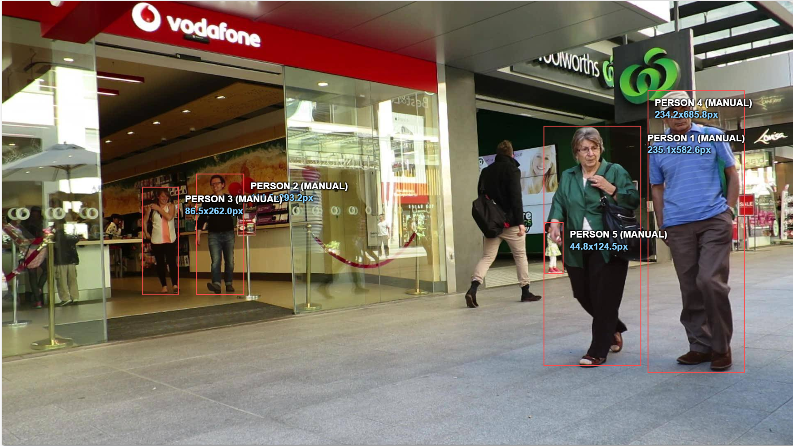
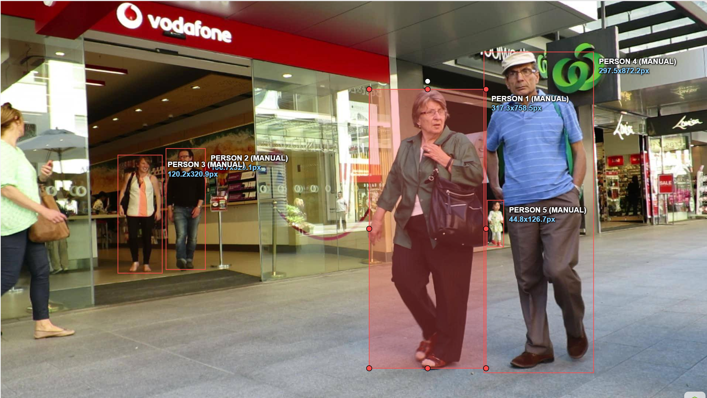

# Báo cáo cá nhân — HoVaTen-MSSV

Đổi tên file theo quy tắc `MSSV_HoTen.md`. Ví dụ: `20241234_NguyenVanAn.md`.

Đoạn video: MOT17-09, 150 frame (frame 1–150), nguồn MOTChallenge, giấy phép CC BY-NC-SA 3.0.

## 0. Thông tin học viên

- Họ tên: Nguyen Thi Hong Hanh
- MSSV: 2A202603272
- Mã đề (A/B/C): A
- Email: 26ai.hanhnth@vinuni.edu.vn
- Link repository: https://github.com/walnut1712/K5-L2B-Day05-NguyenThiHongHanh-2A202603272-MOTTracking
- Giờ bắt đầu: 16:00 13/11/2026
- Giờ kết thúc: 19:30 13/11/2026

## 1. Xem trước đoạn video (CP0)

Ghi **trước khi vẽ**, mỗi người một dòng.

| Mã | Frame xuất hiện | Frame cuối thấy được | Rẽ / dừng / đổi tốc độ ở frame | Bị che ở frame | Ghi chú |
|---|---|---|---|---|---|
| P1 | 0 | 149 | Không có | Không bị che khuất | |
| P2 | 0 | 149 | Không có | 30–59 | |
| P3 | 60 | 149 | Không có | 60–69 | |
| P4 | 39 | 149 | Không có | 39–48, 58 | |
| P5 | 0 | 148 | Không có | 110–117 | Ra khỏi khung ở frame 149 |

## 2. Keyframe và thời gian (CP1, CP4)

Số keyframe lấy từ kết quả `src/check_submission.py`.

| Mã | Số keyframe | Keyframe ở frame | Số frame có mặt | Keyframe / 100 frame | Thời gian (phút) | Chỗ khó |
|---|---:|---|---:|---:|---:|---|
| P1 (Track 0) | 15 | 0, 10, 20, 41, 51, 61, 71, 81, 91, 101, 111, 121, 131, 141, 149 | 150 | 10.0 | 40 | Không có |
| P2 (Track 1) | 15 | 0, 10, 20, 30, 50, 60, 70, 80, 90, 100, 110, 120, 130, 140, 149 | 150 | 10.0 | 45 | Không có |
| P3 (Track 2) | 10 | 60, 70, 80, 90, 100, 110, 120, 130, 140, 149 | 90 | 11.1 | 35 | Không có |
| P4 (Track 3) | 14 | 39, 49, 58, 59, 69, 79, 89, 99, 109, 119, 129, 138, 139, 149 | 111 | 12.6 | 50 | Không có |
| P5 (Track 4) | 10 | 0, 10, 20, 30, 40, 50, 60, 70, 110, 140 | 127 | 7.9 | 40 | Không có |
| **Tổng** | **64** | | **628** | **10.2** | **210** | |


**Keyframe / 100 frame của cả bài:**

= Tổng keyframe ÷ Tổng số frame có mặt × 100

= 64 ÷ 628 × 100

= **10.19 ≈ 10.2 keyframe / 100 frame**

**Bạn đặt keyframe nhiều nhất ở người nào? Vì sao?**

P1 và P2 có số keyframe nhiều nhất, mỗi người có 15 keyframe. P4 có 14 keyframe, trong khi P3 và P5 có 10 keyframe.

Việc phân bổ keyframe khác nhau giúp duy trì bounding box theo từng đối tượng trong video. Khi thực hiện lại, cần ưu tiên đặt keyframe tại những thời điểm có thay đổi đáng kể về vị trí, hướng di chuyển, kích thước hoặc trạng thái che khuất.


## 3. Đoạn bị che (CP2)

**Người bị che:** `P5 (Track 4)`

| Mốc | Frame |
|---|---:|
| Bắt đầu bị che một phần (bật `occluded`) | 110 |
| Mất hẳn (bật `outside`) | 118 |
| Hiện lại (tắt `outside`) | 140 |
| Thấy rõ trở lại (tắt `occluded`) | 140 |

- Thời gian khuất hẳn: **22 frame ≈ 0.73 giây** (giả sử video chạy ở 30 FPS).
- Quyết định: **Giữ cùng ID (P5)**.
- Lý do:
  1. P5 bị khuất hẳn trong 22 frame, ngắn hơn ngưỡng 60 frame.
  2. Khi xuất hiện trở lại, ngoại hình và trang phục của P5 phù hợp với đối tượng trước khi bị che.
  3. Vị trí xuất hiện lại và hướng di chuyển phù hợp với diễn biến trước đó, nên tiếp tục giữ cùng ID để tránh tạo track mới.

**Ảnh chụp màn hình:**
- Trước khi che: `che_1_truoc.png`
- Bắt đầu bị che: `che_2_giua.png`
- Sau khi hiện lại: `che_3_sau.png`

Ảnh chụp màn hình:





## 4. Tự review ID (CP3)

Đã kiểm tra hai lượt: lượt 1 theo từng người (đi ngược từ frame 149 về 0) và lượt 2 theo cảnh (nhảy mỗi 10 frame). Không phát hiện lỗi ID hoặc lỗi tracking.

| Frame | Mã người | Loại lỗi | Mô tả một câu | Phát hiện ở lượt | Đã sửa? |
|---:|---|---|---|---|---|
| - | - | - | Đã kiểm hai lượt, không lỗi | Lượt 1 và lượt 2 | Không cần sửa |
| - | - | - | Không phát hiện hiện tượng đổi ID giữa các đối tượng | Lượt 1 và lượt 2 | Không cần sửa |
| - | - | - | Không phát hiện mất track, phân mảnh hoặc bounding box bị lệch đáng kể | Lượt 1 và lượt 2 | Không cần sửa |

**Tổng hợp số lỗi theo loại:**

| `id_switch` | `fragmentation` | `lost` | `merge` | `false_track` | `drift` | `flag` |
|---:|---:|---:|---:|---:|---:|---:|
| 0 | 0 | 0 | 0 | 0 | 0 | 0 |

**Lỗi nào chỉ lượt 2 (theo cảnh) mới thấy, lượt 1 (theo người) không thấy? Vì sao?**

Không có lỗi nào chỉ được phát hiện ở lượt 2. Cả hai lượt kiểm tra đều không phát hiện lỗi. Việc kiểm tra theo cảnh giúp quan sát đồng thời nhiều đối tượng và đối chiếu tính nhất quán của ID giữa các track.

## 5. File xuất và kết quả tự kiểm (CP4)

| Kiểm tra | Kết quả |
|---|---|
| Tên file MOT 1.1 | `NguyenThiHongHanh_Mot.zip` |
| Tên file CVAT for video 1.1 | `NguyenThiHongHanh_cvat_video.zip` |
| Số track ID khác nhau trong `gt/gt.txt` | 5 – Đạt |
| Tổng số bounding boxes | 628 |
| Frame `outside` không có dòng trong `gt.txt` | Đạt theo script |
| Job đã completed trên CVAT máy cá nhân | Có |

**Tóm tắt kết quả `src/check_submission.py`:**

```text
=== File MOT 1.1: NguyenThiHongHanh_Mot.zip ===
  Số track ID: 5   |   Tổng số box: 628
  [OK]        Đúng 5 track ID.

  Track | Frame có mặt | Số frame | Đoạn vắng (outside)
      1 |   0–149      |      150 | -
      2 |   0–149      |      150 | -
      3 |   0–148      |      127 | 118–139
      4 |  39–149      |      111 | -
      5 |  60–149      |       90 | -

=== File CVAT for video 1.1: NguyenThiHongHanh_cvat_video.zip ===

  Track | Nhãn   | Frame thấy | Keyframe | KF/100 frame | Frame occluded | Lần bật outside
      0 | person |        150 |       15 |         10.0 |              0 |0
      1 | person |        150 |       15 |         10.0 |             30 |0
      2 | person |         90 |       10 |         11.1 |             10 |0
      3 | person |        111 |       14 |         12.6 |             11 |0
      4 | person |        127 |       10 |          7.9 |              8 |2

  Tổng: 64 keyframe / 628 frame có mặt
  = 10.2 keyframe / 100 frame

  [OK] Đọc được 5 track từ annotations.xml.

=== Tóm tắt ===
  Lỗi: 0   |   Cảnh báo: 0
  Đạt. Dán phần tóm tắt này vào báo cáo mục 5.
```

**Kết luận:**

- Đã tạo đủ 5 track ID theo yêu cầu.
- Tổng cộng 628 bounding boxes.
- Tổng cộng 64 keyframes.
- Mật độ keyframe trung bình đạt 10.2 keyframe / 100 frame có mặt.
- Hai file export đều được đọc thành công.
- Script kiểm tra không phát hiện lỗi hoặc cảnh báo.
```

## 6. Ba câu kết

1. Nếu được gán lại, bạn sẽ đặt keyframe khác ở đâu? Vì sao?

- Nếu được gán lại, tôi sẽ bổ sung keyframe quanh các frame 106–118 và 139–140 của P5. Đây là giai đoạn đối tượng bắt đầu bị che khuất, khuất hoàn toàn và xuất hiện trở lại. Việc bổ sung keyframe tại các mốc chuyển tiếp này giúp theo dõi bounding box chính xác hơn và duy trì ID nhất quán.

2. Có chỗ nào bạn không chắc "cùng ID hay ID mới"? Bạn đã quyết định và ghi chú thế nào?

- Tôi chú ý đến trường hợp P5 bị che khuất và xuất hiện trở lại ở frame 140. Tôi quyết định giữ cùng ID vì đối tượng xuất hiện lại có ngoại hình, trang phục và hướng di chuyển phù hợp với track trước đó. Tôi ghi nhận khoảng thời gian bị khuất bằng thuộc tính occluded và outside thay vì tạo track mới.

3. Một lỗi ID trong job của bạn (nếu không còn sót, chọn lỗi đã sửa) có thể làm xe tự lái dự đoán sai chuyển động của người đó như thế nào? Lỗi đó ảnh hưởng MOTA hay IDF1 nhiều hơn?

- Trong job này, tôi không phát hiện lỗi ID sau khi tự review. Tuy nhiên, nếu xảy ra lỗi id_switch, hệ thống có thể nhầm một người đi bộ thành một người khác, khiến việc ước lượng hướng và vận tốc chuyển động không liên tục. Điều này có thể ảnh hưởng đến dự đoán quỹ đạo và thời điểm cảnh báo hoặc phanh của xe tự lái. Lỗi này thường ảnh hưởng IDF1 nhiều hơn MOTA, vì IDF1 đánh giá khả năng duy trì danh tính đối tượng xuyên suốt các frame, trong khi MOTA tổng hợp cả lỗi phát hiện và lỗi ID.

## Bonus (nếu làm)

### B1 — Hai người đi sát

...

### B2 — So cách đặt keyframe

| Cách đặt | Số keyframe | Frame trôi nhất | Ghi chú |
|---|---:|---:|---|
| Đều mỗi 30 frame | | | |
| Theo chỗ đổi hướng | | | |

...

### B3 — So với tracker có sẵn

| Frame | Mã người | Tracker làm gì | Nhãn của bạn | Giải thích (đoán rồi sửa / ghép IoU / box score thấp / ngoại hình) |
|---:|---|---|---|---|
| | | | | |
| | | | | |

## 7. Tài liệu tham khảo và công cụ AI đã dùng
N/A
